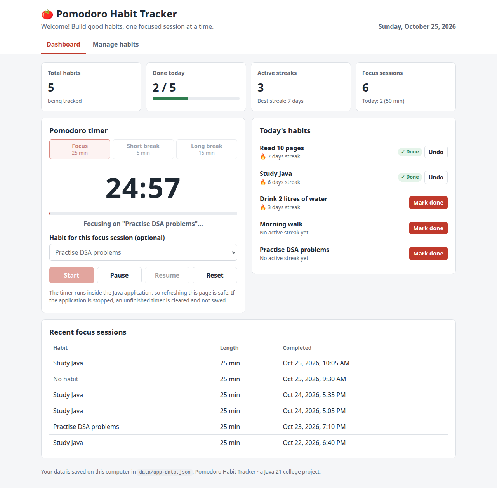
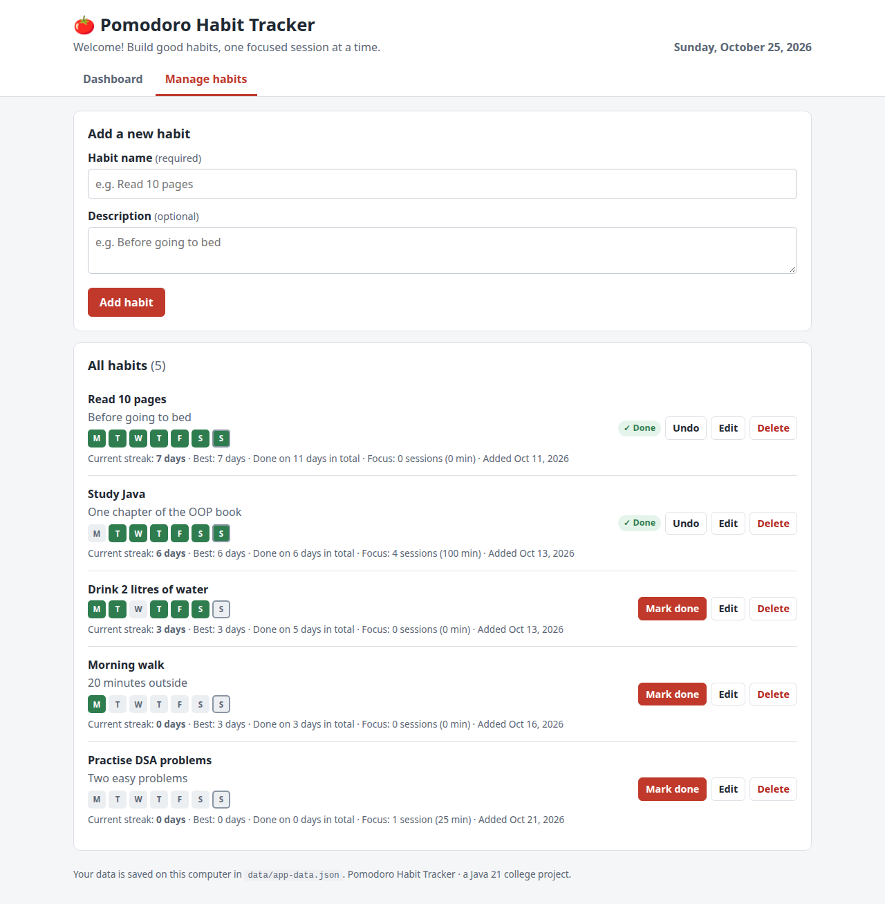
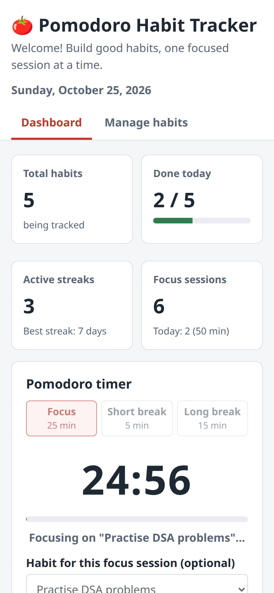
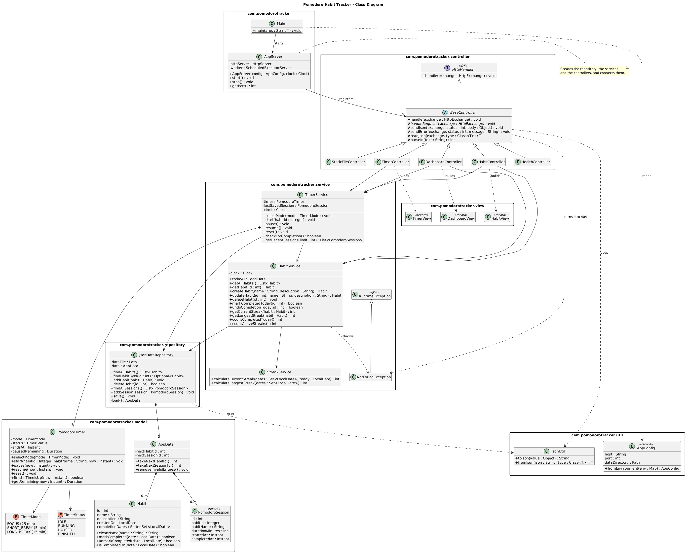
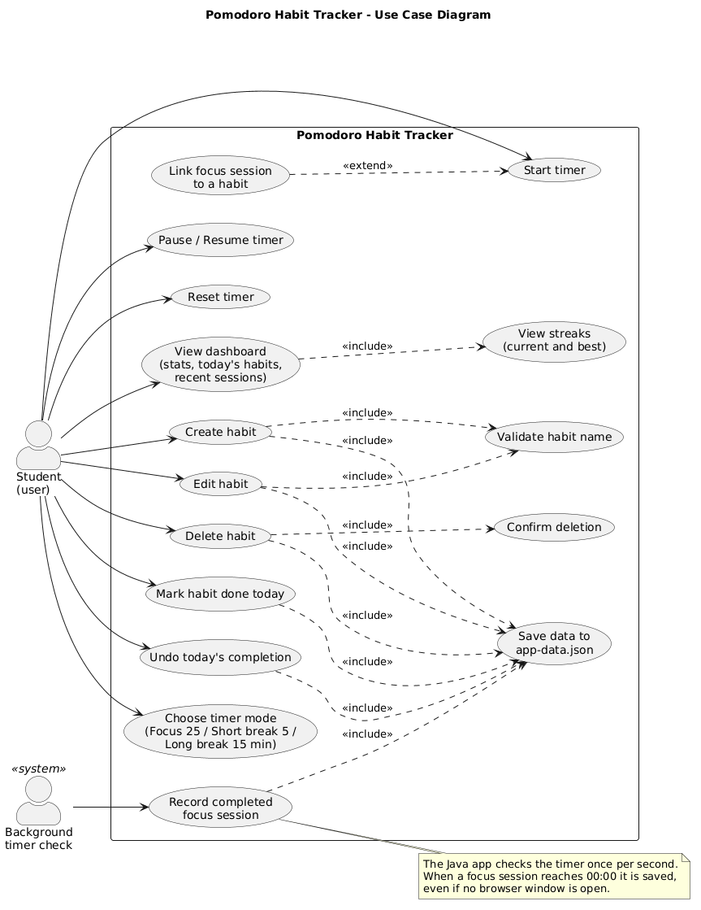
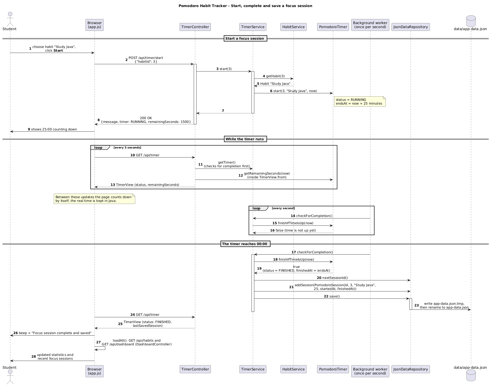

# 🍅 Pomodoro Habit Tracker

A small web application, written in **Java 21**, that combines a **Pomodoro timer**
(25-minute focus sessions with short and long breaks) with **daily habit tracking and streaks**.

It is a college project for practising Core Java, object-oriented programming, the MVC
architecture, JUnit testing and UML. It runs on your own computer at
**<http://127.0.0.1:8080>**: no accounts, no cloud and no database server. Everything is
saved in one JSON file.



<details>
<summary>More screenshots: managing habits, phone layout</summary>




</details>

<sub>Screenshots show sample habits.</sub>

---

## Contents

1. [Features](#1-features)
2. [Technologies](#2-technologies)
3. [Project structure](#3-project-structure)
4. [Architecture (MVC)](#4-architecture-mvc)
5. [Object-oriented programming in this project](#5-object-oriented-programming-in-this-project)
6. [One-time setup (prerequisites)](#6-one-time-setup-prerequisites)
7. [Run on Linux or macOS](#7-run-on-linux-or-macos)
8. [Run on Windows](#8-run-on-windows)
9. [Run with Docker](#9-run-with-docker)
10. [Open and stop the application](#10-open-and-stop-the-application)
11. [Tests and code coverage](#11-tests-and-code-coverage)
12. [UML diagrams](#12-uml-diagrams)
13. [Where the data is stored](#13-where-the-data-is-stored)
14. [How the timer, streaks and saving work](#14-how-the-timer-streaks-and-saving-work)
15. [Web API reference](#15-web-api-reference)
16. [Troubleshooting](#16-troubleshooting)
17. [What was tested](#17-what-was-tested)

---

## 1. Features

**Dashboard**
- App name, a welcome message and today's date.
- Four cards: total habits, habits done today (with a progress bar), active streaks
  (plus the best current streak) and completed focus sessions (plus today's count and minutes).
- *Today's habits* with a **Mark done** / **Undo** button and the current streak.
- *Recent focus sessions*: habit, length and the time each session was completed.

**Habits**
- Add a habit with a name (required, at most 50 characters) and an optional description (at most 200).
- Empty names, names that are too long and duplicate names (ignoring upper/lower case) are rejected
  with a clear message.
- Edit and delete habits. Deleting asks for confirmation first.
- Mark a habit as done for today. Clicking twice still counts as one day, and **Undo** removes today's tick.
- For each habit: current streak, best streak, total days done, a row showing the last 7 days, and the
  focus sessions/minutes spent on it.
- Tested with 60 habits.

**Pomodoro timer**
- Modes: **Focus 25 min**, **Short break 5 min**, **Long break 15 min**.
- **Start**, **Pause**, **Resume** and **Reset**, with the countdown shown as `mm:ss` and a progress bar.
- A focus session can be linked to one of your habits.
- Completed focus sessions are saved with their length, habit, start time and completion time.
- The timer runs inside the Java application, so **refreshing or closing the page does not change it**.
  The countdown is also shown in the browser tab title, and a short beep plays when the time is up.

**Data**
- Saved in `data/app-data.json`. The folder and file are created automatically and loaded at start-up.
- Works without internet after the one-time setup. Nothing is sent to any external service.

---

## 2. Technologies

| Area | Technology | Version used |
|------|------------|--------------|
| Language | Java (OpenJDK) | 21 (21.0.10 from conda-forge) |
| Web server | Java's built-in `com.sun.net.httpserver.HttpServer` | part of Java 21 |
| JSON | Gson | 2.15.0 |
| Build tool | Maven | 3.9 (3.9.16 from conda-forge) |
| Unit tests | JUnit 5 (Jupiter) | 5.14.4 |
| Code coverage | JaCoCo | 0.8.15 |
| User interface | HTML, CSS, plain JavaScript (no frameworks, no external files) | |
| Diagrams | PlantUML | 1.2026.9 (for the PNGs) |
| Environment | Conda with `environment.yml` (conda-forge channel) | |
| Containers | Docker + Docker Compose (`maven:3.9-eclipse-temurin-21` to build, `eclipse-temurin:21-jre-alpine` to run) | |

No Spring Boot, React, Node.js or database server. The only library the application uses is Gson.

---

## 3. Project structure

```
pomodoro-habit-tracker/
├── src/main/java/com/pomodorotracker/
│   ├── Main.java                  starts the app and prints the address
│   ├── AppServer.java             creates all objects and the web server
│   ├── model/                     MODEL: the data and its rules
│   │   ├── Habit.java             a habit + the days it was done
│   │   ├── PomodoroSession.java   a completed focus session (record)
│   │   ├── PomodoroTimer.java     the timer state machine
│   │   ├── TimerMode.java         FOCUS / SHORT_BREAK / LONG_BREAK (enum)
│   │   ├── TimerStatus.java       IDLE / RUNNING / PAUSED / FINISHED (enum)
│   │   └── AppData.java           everything stored in the JSON file
│   ├── repository/
│   │   └── JsonDataRepository.java   loads and saves data/app-data.json
│   ├── service/                   business logic
│   │   ├── HabitService.java      create/edit/delete/complete habits
│   │   ├── StreakService.java     current and longest streak
│   │   ├── TimerService.java      timer actions + saving finished sessions
│   │   └── NotFoundException.java
│   ├── controller/                CONTROLLER: handles the web requests
│   │   ├── BaseController.java    shared JSON + error handling (abstract)
│   │   ├── HabitController.java   /api/habits...
│   │   ├── TimerController.java   /api/timer...
│   │   ├── DashboardController.java  /api/dashboard
│   │   ├── HealthController.java  /api/health
│   │   └── StaticFileController.java  serves the web page files
│   ├── view/                      VIEW models: the JSON the page receives
│   │   ├── HabitView.java
│   │   ├── TimerView.java
│   │   └── DashboardView.java
│   └── util/
│       ├── AppConfig.java         settings from environment variables
│       └── JsonUtil.java          Gson setup (dates as text)
├── src/main/resources/static/     VIEW: index.html, style.css, app.js
├── src/test/java/com/pomodorotracker/   JUnit 5 tests (8 test classes)
├── docs/uml/                      PlantUML diagrams (.puml) + PNG images
├── docs/screenshots/              screenshots used in this README
├── data/                          your saved data (created automatically)
├── pom.xml                        Maven build (dependencies, JAR, JaCoCo)
├── environment.yml                Conda environment: Java 21 + Maven
├── Dockerfile                     two-stage Docker build
├── compose.yaml                   Docker Compose (port + data volume)
├── .dockerignore  .gitignore  .gitattributes
├── run.sh                         one-command start for Linux/macOS
├── run.bat                        one-command start for Windows (Command Prompt)
└── run.ps1                        one-command start for Windows (PowerShell)
```

---

## 4. Architecture (MVC)

The project follows **Model–View–Controller**, plus a *service* layer for the business
logic and a *repository* layer for saving. Each layer only talks to the layer below it.

```
 Browser  ──  VIEW: index.html + style.css + app.js  (shows data, sends clicks)
    │  HTTP requests with JSON  (fetch("/api/..."))
    ▼
 CONTROLLER  (controller/)      reads the request, calls a service, sends JSON back
    │                           using the view records in view/ (HabitView, TimerView ...)
    ▼
 SERVICE  (service/)            the rules: validation, streaks, timer, statistics
    │
    ▼
 REPOSITORY  (repository/)      the only class that reads/writes data/app-data.json
    │
 MODEL  (model/)                Habit, PomodoroSession, PomodoroTimer, AppData ...
```

**Example: clicking "Mark done"**
1. `app.js` sends `POST /api/habits/3/complete`.
2. `HabitController` reads the id `3` and calls `habitService.markCompletedToday(3)`.
3. `HabitService` finds the habit and calls `habit.markCompleted(today)`.
   The `Habit` model ignores a second click on the same day.
4. `HabitService` calls `repository.save()`, which writes the JSON file.
5. The controller builds a `HabitView` (with the new streak) and sends it back as JSON.
6. `app.js` shows *"Well done! ... Streak: 4 days."* and redraws the lists.

The Java code never creates HTML, and the JavaScript never calculates streaks or timer
states. It only displays what the Java API returns.

---

## 5. Object-oriented programming in this project

| Concept | Where to find it |
|---------|------------------|
| **Encapsulation** | `Habit` keeps its fields `private`. The name can only be changed through `setName()`, which validates it. `getCompletionDates()` returns a *read-only* set, so other classes must use `markCompleted()`, which counts each day only once. `PomodoroTimer` can only change state through `start()`, `pause()`, `resume()` and `reset()`, which reject impossible actions. |
| **Inheritance** | `HabitController`, `TimerController`, `DashboardController`, `HealthController` and `StaticFileController` all **extend** the abstract `BaseController`, which contains the shared code for JSON and error handling. `NotFoundException` extends `RuntimeException`. The two date adapters in `JsonUtil` extend Gson's `TypeAdapter`. |
| **Polymorphism** | Java's `HttpServer` only knows the `HttpHandler` interface. It calls `handle()` on every controller in the same way, and `BaseController.handle()` then calls the overridden `handleRequest()` of the actual controller. The services accept any `java.time.Clock`: the real clock in the app, and a `MutableClock` subclass in the tests that can "jump" 25 minutes or 3 days. |
| **Abstraction** | `BaseController` is `abstract` and declares `handleRequest()` without a body. Controllers call services without knowing how the data is stored. |
| **Records and enums** | `PomodoroSession` is a `record` (a finished session never changes). `TimerMode` is an `enum` that stores each mode's label and minutes. |

---

## 6. One-time setup (prerequisites)

You install these tools **once**. After that, starting the app is a single command
(sections 7–9).

### Option A – Conda (to run the app directly on your computer)

You only need **Conda**. You do **not** need to install Java or Maven yourself: the start
scripts create a Conda environment with Java 21 and Maven in it.

1. Install **Miniforge** (free, recommended): <https://conda-forge.org/download/>.
   Miniconda or Anaconda also work.
2. That's all. The first start downloads Java 21 and Maven into an environment named
   `pomodoro-habit-tracker` (about 190 MB to download, about 560 MB on disk) and then the
   Maven plugins and libraries (about 30 MB). **An internet connection is needed for this
   first start only.**

The environment is described in [`environment.yml`](environment.yml) (conda-forge channel,
OpenJDK 21 and Maven 3.9) and works on Linux, macOS and Windows.

### Option B – Docker (no Conda or Java needed)

- **Windows / macOS:** install **Docker Desktop**: <https://www.docker.com/products/docker-desktop/>
- **Linux:** install **Docker Engine** and the **Docker Compose plugin**: <https://docs.docker.com/engine/install/>

The first `docker compose up --build` downloads the Java/Maven images and needs internet.

---

## 7. Run on Linux or macOS

Open a terminal in the project folder and run:

```bash
./run.sh
```

What the script does:
1. Finds Conda, even if `conda init` was never run in this terminal.
2. Creates the `pomodoro-habit-tracker` environment from `environment.yml` if it doesn't exist yet
   (first run only; later runs skip this step).
3. Builds the app with Maven (`target/pomodoro-habit-tracker.jar`).
4. Starts it in the foreground and prints **<http://127.0.0.1:8080>**.

You can call it from any folder, for example `~/projects/pomodoro-habit-tracker/run.sh`.
If you get *Permission denied*, run `chmod +x run.sh` once, or start it with `bash run.sh`.

To use another port: `APP_PORT=8081 ./run.sh`

<details>
<summary>The same steps by hand (without the script)</summary>

```bash
conda env create -f environment.yml        # only once
conda activate pomodoro-habit-tracker
mvn clean package                          # builds the JAR and runs the tests
java -jar target/pomodoro-habit-tracker.jar
```
</details>

---

## 8. Run on Windows

You do not need Bash. Open the project folder and use **one** of these:

**Command Prompt**
```bat
run.bat
```
(You can also double-click `run.bat` in File Explorer.)

**PowerShell**
```powershell
powershell -ExecutionPolicy Bypass -File .\run.ps1
```
`-ExecutionPolicy Bypass` lets Windows run this one script, even though PowerShell blocks
scripts by default. It doesn't change any system setting.

Both scripts do the same as `run.sh`: find Conda (Miniforge, Miniconda or Anaconda, also
without `conda init`), create the environment on the first run, build with Maven, and start
the app at **<http://127.0.0.1:8080>**.

To use another port:
- Command Prompt: `set APP_PORT=8081` and then `run.bat`
- PowerShell: `$env:APP_PORT = "8081"` and then the command above

---

## 9. Run with Docker

From the project folder:

```bash
docker compose up --build
```

Then open **<http://127.0.0.1:8080>**. This works the same on Windows, macOS and Linux.

- **Stop:** press `Ctrl+C`, or run `docker compose down` from another terminal.
- **Run in the background:** `docker compose up --build -d`. See the logs with
  `docker compose logs -f`, and stop with `docker compose down`.
- **Data:** stored in the Docker volume `pomodoro-habit-tracker_pomodoro-data`, outside
  the image. It survives restarts, rebuilds and `docker compose down`.
  Only `docker compose down -v` deletes it.
- **Time zone:** the container uses UTC unless you tell it your time zone. This matters,
  because "today" decides which day a habit is marked for. Create a file named `.env` next to
  `compose.yaml` containing your time zone, for example:
  ```
  TZ=Asia/Kolkata
  ```
- **Port 8080 already in use?** Add `HOST_PORT=9090` to the same `.env` file and open
  <http://127.0.0.1:9090>.
- **Back up your Docker data:** `docker compose cp app:/app/data/app-data.json ./my-backup.json`

How the image is built ([`Dockerfile`](Dockerfile)): stage 1 uses Maven + Java 21 to build
the JAR; stage 2 copies only the JAR into a small Java 21 runtime image (Alpine) and runs it
as a non-root user. Inside the container the app listens on `0.0.0.0:8080`, but
`compose.yaml` only publishes it on `127.0.0.1` of your computer, so other devices on your
network cannot reach it. Docker also checks `/api/health` every 30 seconds
(`docker compose ps` shows `healthy`).

---

## 10. Open and stop the application

- **Open:** go to **<http://127.0.0.1:8080>** in any modern browser (Chrome, Edge, Firefox, Safari).
  `http://localhost:8080` works too.
- **Stop:** press **`Ctrl+C`** in the terminal where the app is running. Every change is saved
  immediately, so stopping never loses data, except an unfinished timer (see section 14).
  On Windows, Command Prompt may then ask *"Terminate batch job (Y/N)?"*. Answer `Y`.

Settings (environment variables, all optional):

| Variable | Default | Meaning |
|----------|---------|---------|
| `APP_PORT` | `8080` | Port number |
| `APP_HOST` | `127.0.0.1` | Network address; the default means "this computer only" |
| `APP_DATA_DIR` | `data` | Folder for `app-data.json` |

---

## 11. Tests and code coverage

The tests are in `src/test/java`. Run them, together with the build and the coverage
report, with one command:

```bash
conda activate pomodoro-habit-tracker
mvn clean verify
```

(Without activating: `conda run -n pomodoro-habit-tracker mvn clean verify`.)

| Test class | Tests | What it checks |
|------------|------:|----------------|
| `model/HabitTest` | 2 | name/description trimming and validation; a day counts only once; undo; read-only dates |
| `model/PomodoroTimerTest` | 6 | start, pause, resume, reset, finishing exactly once at the real end time, invalid actions, break lengths |
| `service/StreakServiceTest` | 4 | consecutive days (also across a month end and a leap day), streak kept until midnight, reset after a missed day, longest streak |
| `service/HabitServiceTest` | 7 | create + validation, duplicate names, edit (all or nothing), delete, double completion, streak over several days with a missed day, **60 habits** saved and reloaded |
| `service/TimerServiceTest` | 4 | a finished focus session is saved with habit, length and timestamps; paused time doesn't count; reset and breaks are not saved; unknown habit |
| `repository/JsonDataRepositoryTest` | 5 | creates folder and file; save and load; ids never reused; **broken file is backed up**; missing fields, `null` entries and empty files |
| `util/AppConfigTest` | 2 | default settings, environment variables, invalid port |
| `controller/ApiIntegrationTest` | 4 | starts the real server on a free port and tests the page, every habit and timer action, and the error codes (400/403/404/405/409) over HTTP |
| **Total** | **34** | |

The tests never touch your real `data/` folder. Each test gets a fresh temporary folder
(JUnit `@TempDir`), and the timer tests use a fake clock, so they finish in seconds
instead of waiting 25 minutes.

**Coverage report:** after `mvn clean verify`, open `target/site/jacoco/index.html` in a browser
(Linux: `xdg-open target/site/jacoco/index.html`, macOS: `open ...`, Windows: `start target\site\jacoco\index.html`).
The build **fails** if line coverage of the core logic (`model`, `service`, `repository`) drops below 80%.

Measured with `mvn clean verify`, JaCoCo 0.8.15:

| Code | Line coverage | Branch coverage |
|------|--------------:|----------------:|
| Core logic: `model` + `service` + `repository` | **96.7%** (352 / 364 lines) | **88.2%** (127 / 144 branches) |
| `model` | 98.6% | 87.5% |
| `service` | 100.0% | 88.3% |
| `repository` | 83.9% | 91.7% |
| `controller` | 82.4% | 61.0% |
| `view` | 100.0% | 100.0% |
| `util` | 100.0% | 78.6% |
| `Main` + `AppServer` (start-up code; `Main` has no unit test) | 32.8% | – (no branches) |
| **Whole project** | **86.6%** (621 / 717 lines) | **77.2%** (206 / 267 branches) |

*Line coverage* = how many lines of code the tests executed. *Branch coverage* = how many of the
possible directions of every `if`/`switch` were taken (both the "yes" and the "no" way).
Branch coverage is lower because some error paths (for example a disk that cannot be written) are
hard to trigger in a unit test.

---

## 12. UML diagrams

The PlantUML sources and rendered PNGs are in [`docs/uml/`](docs/uml/). See
[`docs/uml/README.md`](docs/uml/README.md) for how to render or preview them (VS Code,
IntelliJ, Docker, the PlantUML JAR or online).

| Diagram | Shows |
|---------|-------|
| [Use case](docs/uml/use-case-diagram.puml) | What a student can do (habits, timer, dashboard), and the background timer check that records finished sessions. |
| [Class](docs/uml/class-diagram.puml) | All packages and main classes, inheritance (`BaseController` → 5 controllers), composition and dependencies. |
| [Sequence](docs/uml/sequence-diagram.puml) | Starting a focus session, the countdown, and saving the session when it reaches 00:00. |



<details>
<summary>Use case and sequence diagrams</summary>




</details>

---

## 13. Where the data is stored

| How you run the app | Data location |
|---------------------|---------------|
| `run.sh`, `run.bat`, `run.ps1` | `data/app-data.json` inside the project folder |
| `java -jar ...` by hand | `data/app-data.json` in the folder you start it from (or `APP_DATA_DIR`) |
| Docker | the Docker volume `pomodoro-habit-tracker_pomodoro-data` (file `/app/data/app-data.json` in the container) |
| Tests | temporary folders that JUnit deletes afterwards |

The file is plain, readable JSON:

```json
{
  "nextHabitId": 2,
  "nextSessionId": 2,
  "habits": [
    {
      "id": 1,
      "name": "Read 10 pages",
      "description": "Before going to bed",
      "createdOn": "2026-10-20",
      "completionDates": ["2026-10-23", "2026-10-24", "2026-10-25"]
    }
  ],
  "sessions": [
    {
      "id": 1,
      "habitId": 1,
      "habitName": "Read 10 pages",
      "durationMinutes": 25,
      "startedAt": "2026-10-25T03:30:00.000Z",
      "completedAt": "2026-10-25T03:55:00.000Z"
    }
  ]
}
```

- **Back up:** copy the file. **Start fresh:** stop the app and delete the file.
- Times are stored in UTC (the `Z` at the end); the page shows them in your local time.
- `data/` is listed in `.gitignore`, so your personal data is never committed to Git.

---

## 14. How the timer, streaks and saving work

### The timer
- When you press **Start**, the Java `PomodoroTimer` stores **when the time will run out**
  (`endsAt = now + 25 minutes`). It does not count down second by second; the remaining time
  is calculated as `endsAt − now` whenever someone asks.
- **Pause** stores the remaining time. **Resume** sets a new end time (`now + remaining`),
  so paused minutes never count as focus time.
- The page asks Java for the real state every 5 seconds and counts down smoothly in between.
  **Refreshing the page is therefore safe**: the new page simply asks Java again.
- A background task in Java checks the timer **once per second**. When a *focus* session reaches
  00:00 it is saved straight away, with the habit, the length (25 minutes), the start time and
  the exact end time, **even if no browser is open**. Breaks are not saved. **Reset** throws
  away an unfinished session.
- **If the Java application is stopped or restarted while a timer is running or paused, that
  unfinished session is lost.** The timer only lives in memory, so after a restart it shows
  `25:00` again. Completed sessions were already written to the file and are kept. This keeps the
  design simple: the app cannot know whether you kept working while it was not running, so it does not
  guess.

### Streaks
A habit's dates are stored in a `Set`, so each day counts once. The current streak counts
backwards day by day:

| Completed on | Today | Current streak | Why |
|--------------|-------|---------------:|-----|
| 23, 24, 25 Oct | 25 Oct | 3 | three days in a row, ending today |
| 23, 24 Oct | 25 Oct | 2 | not done yet today, but the streak stays alive until midnight |
| 22, 23 Oct | 25 Oct | 0 | 24 Oct was missed, so the streak is broken |
| 25 Oct (clicked twice) | 25 Oct | 1 | the same day only counts once |

The **best streak** is the longest run of consecutive days ever. "Today" means today's date in
your computer's time zone (in Docker: the `TZ` setting).

### Saving
- At start-up the whole file is loaded into memory. After **every** change, the whole file is
  written again: first to `app-data.json.tmp`, then renamed to `app-data.json`. If the computer
  crashes while writing, the old file is still complete.
- If the file is damaged (for example after editing it by hand), it is renamed to
  `app-data-broken-<date-time>.json`, a warning is printed, and the app starts with empty data.
  Nothing is deleted.
- Habit ids are never reused, so old focus sessions can never point to a different habit.

---

## 15. Web API reference

The page talks to these URLs. You can also try them with `curl` or a browser.
Requests and responses use JSON.

| Method | URL | Body | Result |
|--------|-----|------|--------|
| GET | `/api/health` | – | `{"status": "ok"}` |
| GET | `/api/dashboard` | – | numbers for the cards + the 10 most recent sessions |
| GET | `/api/habits` | – | all habits with streaks and the last 7 days |
| POST | `/api/habits` | `{"name": "Read", "description": ""}` | creates a habit (`201 Created`) |
| GET | `/api/habits/{id}` | – | one habit |
| PUT | `/api/habits/{id}` | `{"name": "...", "description": "..."}` | edits a habit |
| DELETE | `/api/habits/{id}` | – | deletes a habit |
| POST | `/api/habits/{id}/complete` | – | marks it done today |
| POST | `/api/habits/{id}/uncomplete` | – | undoes today's completion |
| GET | `/api/timer` | – | timer state and remaining seconds |
| POST | `/api/timer/mode` | `{"mode": "FOCUS"}`, `"SHORT_BREAK"` or `"LONG_BREAK"` | chooses the mode |
| POST | `/api/timer/start` | `{"habitId": 1}` (optional) | starts the timer |
| POST | `/api/timer/pause` | – | pauses |
| POST | `/api/timer/resume` | – | resumes |
| POST | `/api/timer/reset` | – | resets (unfinished session is not saved) |

Example:
```bash
curl -X POST http://127.0.0.1:8080/api/habits -H "Content-Type: application/json" -d "{\"name\": \"Read 10 pages\"}"
```

Errors come back as `{"error": "a readable message"}` with a fitting status code:
`400` invalid input (for example an empty name), `403` request from another website,
`404` unknown habit or URL, `405` wrong HTTP method, `409` action not possible right now
(for example *Pause* when the timer is not running), `500` unexpected server problem.

---

## 16. Troubleshooting

| Problem | Solution |
|---------|----------|
| `Conda was not found` | Install Miniforge (section 6) and open a **new** terminal. If Conda is installed in an unusual folder, start the script from an *Anaconda/Miniforge Prompt*, or set `CONDA_EXE` to the full path of the `conda` program. |
| `./run.sh: Permission denied` | Run `chmod +x run.sh` once, or use `bash run.sh`. |
| `Port 8080 ... is already in use` | Another program (or a second copy of this app) uses the port. Close it, or use another port: `APP_PORT=8081 ./run.sh` (see section 8 for Windows; for Docker set `HOST_PORT` in `.env`). |
| PowerShell: *running scripts is disabled on this system* | Start it as shown in section 8: `powershell -ExecutionPolicy Bypass -File .\run.ps1`, or use `run.bat`. |
| Creating the environment failed or was interrupted | Check your internet connection, run `conda env remove -n pomodoro-habit-tracker`, then start the script again. |
| Conda asks you to accept *Terms of Service* | `environment.yml` only uses the free conda-forge channel. If your Conda still asks about the `defaults` channel, run `conda tos accept` or use Miniforge. |
| `Java or Maven is missing in the Conda environment` | Repair it: `conda env update -n pomodoro-habit-tracker -f environment.yml --prune` |
| Maven cannot download plugins | The first build needs internet access to Maven Central. Behind a proxy, configure it in `~/.m2/settings.xml`. |
| `mvn: command not found` when running tests | Activate the environment first: `conda activate pomodoro-habit-tracker` (or use `conda run -n pomodoro-habit-tracker mvn clean verify`). |
| The page says *Cannot reach the Java application* | The app was stopped. Start it again; the page reconnects automatically. |
| A habit was marked for the wrong day in Docker | The container uses UTC. Set your time zone with `TZ=...` in `.env` (section 9). The page shows a yellow note if the app's date differs from your computer's date. |
| `WARNING: ... could not be read` at start-up | The data file was damaged. It was renamed to `app-data-broken-<time>.json` in the data folder. Fix the JSON in that file and rename it back to `app-data.json` to restore it. |
| Docker on Linux: *permission denied ... docker.sock* | Add your user to the `docker` group (`sudo usermod -aG docker $USER`, then log out and in) or use `sudo docker compose ...`. |
| `mvn clean verify` fails with *Coverage checks have not been met* | A code change lowered the test coverage of `model`/`service`/`repository` below 80%. Add tests for the new code. |

---

## 17. What was tested

Checked on Ubuntu 24.04 with Conda 26.7 (OpenJDK 21.0.10, Maven 3.9.16) and Docker 29.7 / Compose 5.4:

- `mvn clean verify`: **34 tests, 0 failures**; coverage as in section 11.
- `run.sh`: first run on a simulated fresh computer (a new Miniforge without `conda init` and an
  empty home folder), where it created the environment, built and started the app. Also: a normal run,
  starting from another folder, Conda installed but not initialised, Conda missing (clear error),
  port already in use (clear error, data untouched), and `Ctrl+C` (clean stop, port released).
- `run.ps1`: run with **PowerShell 7 on Linux**: environment creation, normal run, Conda not
  initialised, Conda missing, `Ctrl+C`. It was **not** run on Windows itself, and Windows PowerShell 5.1
  was not tested.
- `mvn clean verify` also passed with an empty Maven cache (about 30 MB downloaded) and afterwards in
  Maven's offline mode, so no internet is needed after the first build.
- `run.bat`: **not executed** (no Windows computer was available). It was reviewed carefully and
  follows the official Conda layout for Windows (`condabin\conda.bat`, `Library\bin\java.exe`, `mvn.cmd`).
- The web page was clicked through in a real browser (headless Chromium): adding, validating,
  editing, completing, undoing and deleting habits; every timer button; refreshing during a
  session; a phone-sized screen; no JavaScript errors.
- Real-time runs with the real clock: a 25-minute focus session was saved with **no browser open**,
  and a full focus session followed by a 5-minute break was watched in the browser.
- Data survived an app restart and a Docker container re-creation; `TZ` changes "today" in Docker.
